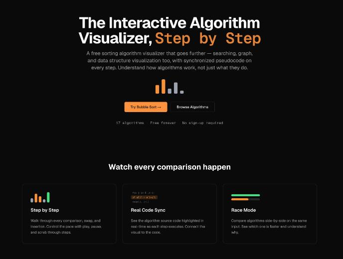
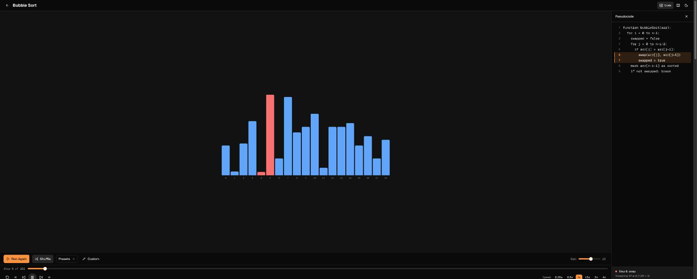

# VizStep: Interactive Algorithm Visualizer

**Watch sorting, searching, graph and data structure algorithms run step by step, with synchronized pseudocode on every step.**

[**Try it free at vizstep.com →**](https://vizstep.com)

Free forever · No sign-up · Works in the browser

## What is VizStep?

[VizStep](https://vizstep.com) is a free, browser-based **algorithm visualizer** for students, self-taught developers and anyone preparing for coding interviews. Instead of only showing the final result, it walks through every comparison, swap, insertion and rotation so you understand *how* an algorithm works, not just *what* it does.

| Feature | What it does |
|---|---|
| **Step-by-step playback** | Play, pause, step forward and back, and scrub through every operation at your own pace |
| **Real code sync** | The pseudocode line that is running is highlighted as each step executes |
| **Race mode** | Run two algorithms side by side on the same input to see which is faster and why |
| **Complexity analysis** | Best, average and worst-case time and space complexity on every page |
| **Code examples** | Implementations in JavaScript, Python and Java |
| **No sign-up** | Every feature works instantly, with no account and no tracking of personal data |

## Algorithms and data structures

### Sorting algorithms

| Algorithm | Time (average) | Visualizer |
|---|---|---|
| Bubble Sort | O(n²) | [Bubble sort visualization](https://vizstep.com/workspace/bubble-sort) |
| Selection Sort | O(n²) | [Selection sort visualization](https://vizstep.com/workspace/selection-sort) |
| Insertion Sort | O(n²) | [Insertion sort visualization](https://vizstep.com/workspace/insertion-sort) |
| Merge Sort | O(n log n) | [Merge sort visualization](https://vizstep.com/workspace/merge-sort) |
| Quick Sort | O(n log n) | [Quick sort visualization](https://vizstep.com/workspace/quick-sort) |

### Searching algorithms

| Algorithm | Time | Visualizer |
|---|---|---|
| Linear Search | O(n) | [Linear search visualization](https://vizstep.com/workspace/linear-search) |
| Binary Search | O(log n) | [Binary search visualization](https://vizstep.com/workspace/binary-search) |

### Graph algorithms

| Algorithm | Time | Visualizer |
|---|---|---|
| Breadth-First Search (BFS) | O(V + E) | [BFS visualization](https://vizstep.com/workspace/bfs) |
| Depth-First Search (DFS) | O(V + E) | [DFS visualization](https://vizstep.com/workspace/dfs) |
| Dijkstra's Algorithm | O(V²) | [Dijkstra visualization](https://vizstep.com/workspace/dijkstra) |

### Data structures

| Data structure | Key operations | Visualizer |
|---|---|---|
| Stack (LIFO) | Push / pop in O(1) | [Stack visualization](https://vizstep.com/workspace/stack) |
| Queue (FIFO) | Enqueue / dequeue in O(1) | [Queue visualization](https://vizstep.com/workspace/queue) |
| Linked List | Insert, delete, search in O(n) | [Linked list visualization](https://vizstep.com/workspace/linked-list) |
| Binary Search Tree | Insert, search, delete in O(log n) average | [BST visualization](https://vizstep.com/workspace/binary-search-tree) |
| AVL Tree | Self-balancing with rotations, O(log n) | [AVL tree visualization](https://vizstep.com/workspace/avl-tree) |
| Min/Max Heap | Insert / extract in O(log n) | [Heap visualization](https://vizstep.com/workspace/heap) |
| Hash Table | Lookup in O(1) average with chaining | [Hash table visualization](https://vizstep.com/workspace/hash-table) |

## Side-by-side comparisons

Not sure which algorithm to use? Each comparison page explains the key differences, with a table and a live race.

| Comparison | Comparison | Comparison |
|---|---|---|
| [Quick Sort vs Merge Sort](https://vizstep.com/compare/quick-sort-vs-merge-sort) | [Bubble Sort vs Insertion Sort](https://vizstep.com/compare/bubble-sort-vs-insertion-sort) | [Selection Sort vs Insertion Sort](https://vizstep.com/compare/selection-sort-vs-insertion-sort) |
| [BFS vs DFS](https://vizstep.com/compare/bfs-vs-dfs) | [BFS vs Dijkstra](https://vizstep.com/compare/bfs-vs-dijkstra) | [Linear Search vs Binary Search](https://vizstep.com/compare/linear-search-vs-binary-search) |
| [Stack vs Queue](https://vizstep.com/compare/stack-vs-queue) | [BST vs AVL Tree](https://vizstep.com/compare/binary-search-tree-vs-avl-tree) | [All comparisons →](https://vizstep.com/compare) |

## Cheat sheets and guides

| Resource | Description |
|---|---|
| [Big O Time Complexity Cheat Sheet](https://vizstep.com/cheat-sheets/time-complexity) | Time and space complexity of every common algorithm in one table |
| [Sorting Algorithms Cheat Sheet](https://vizstep.com/cheat-sheets/sorting-algorithms) | Complexity, stability and best use case for each sorting algorithm |
| [Big O Notation Explained Visually](https://vizstep.com/blog/big-o-notation-explained-visually) | A visual introduction to Big O notation |
| [How Bubble Sort Works](https://vizstep.com/blog/how-bubble-sort-works) | A step-by-step walkthrough with animations |
| [Quicksort vs Merge Sort](https://vizstep.com/blog/quicksort-vs-merge-sort) | When to choose each and why |

## Who is it for?

| Audience | How VizStep helps |
|---|---|
| **CS students** | See what your lecture slides describe, one step at a time |
| **Interview prep** | Build intuition for sorting, searching, trees and graphs before LeetCode |
| **Teachers and TAs** | Project a live visualization in class, free and with no accounts for students |
| **Self-taught developers** | Connect the animation to real code in JavaScript, Python and Java |

## Feedback and suggestions

Want an algorithm added, or found a bug? [Open an issue](../../issues) or reach out through [vizstep.com](https://vizstep.com/about).

If VizStep helped you learn, please ⭐ **star this repo** so other students can find it.

---

**[vizstep.com](https://vizstep.com)**: free interactive algorithm visualizer

